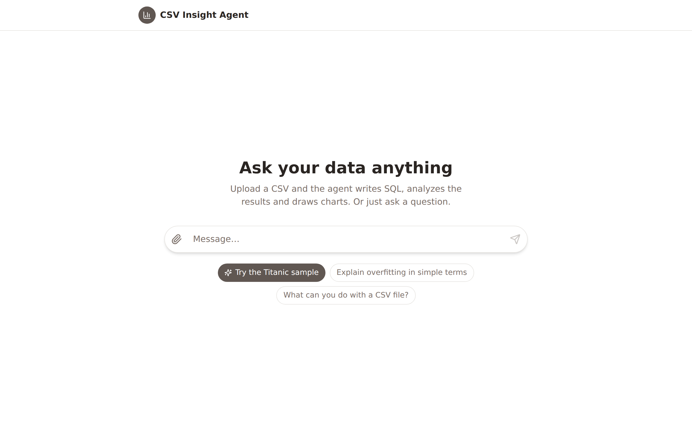
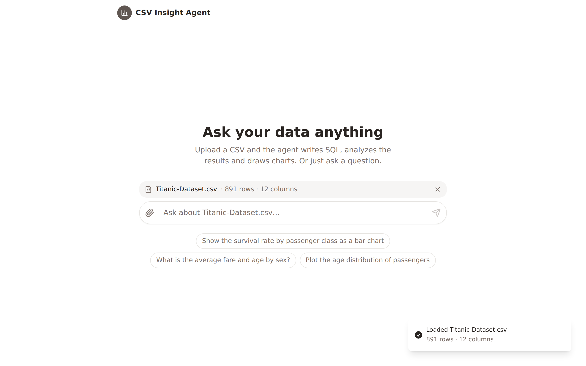
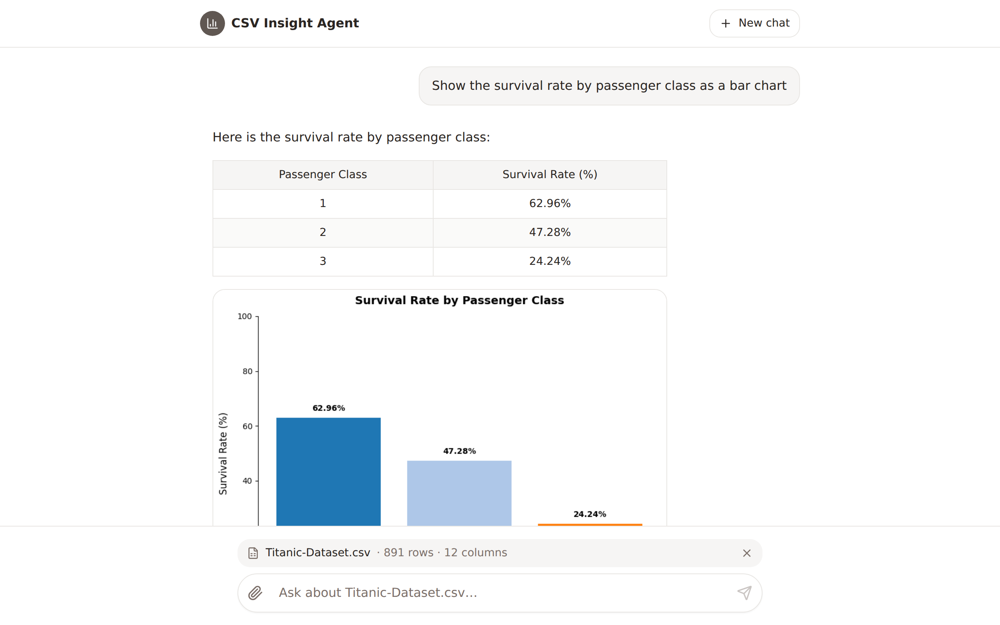
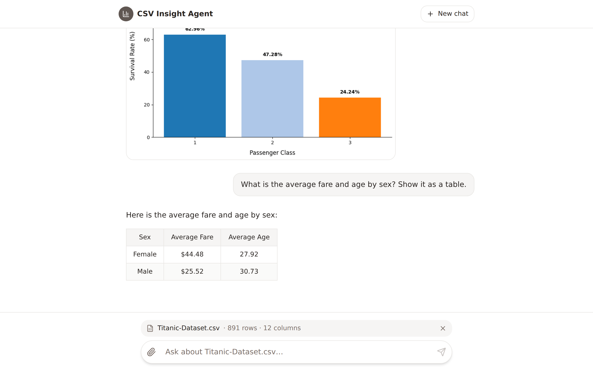
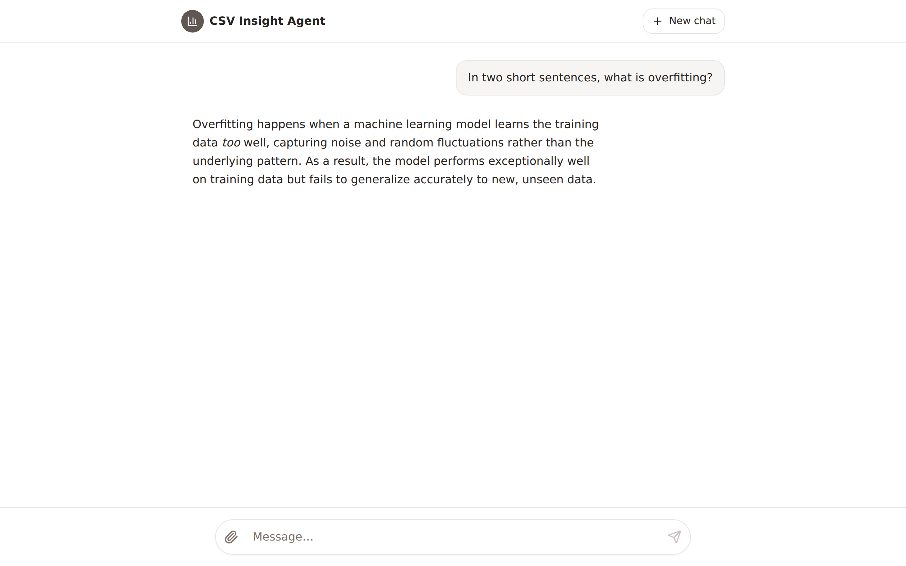
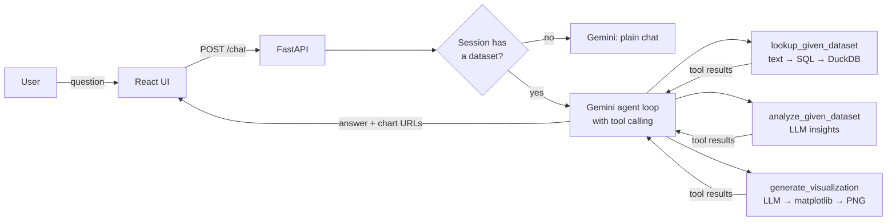

# CSV Insight Agent

**Chat with your CSV files.** Upload a dataset and ask questions in plain English. An AI agent decides which tools to use: it writes and runs SQL, analyzes the results and draws charts. With no file uploaded, it works as a general chat assistant.


<sub>Full-quality video: [docs/demo.mp4](docs/demo.mp4)</sub>

## Features

- **Tool-calling agent loop.** The LLM chooses between three tools: SQL lookup, data analysis and visualization. It chains them until it can answer.
- **Text-to-SQL on DuckDB.** Questions become read-only SQL that runs in memory against the uploaded CSV.
- **Auto-generated charts.** The agent writes matplotlib code for the query result, runs it on the server and returns a PNG.
- **Two modes, one endpoint.** `/chat` uses the data tools when the session has a dataset and plain chat when it doesn't. Both keep conversation memory.
- **React chat UI.** Markdown tables, inline charts, a dataset badge, suggested prompts and a one-click Titanic sample.
- **Works with any OpenAI-compatible provider.** It defaults to Google Gemini through its OpenAI-compatible endpoint.

## Screenshots

| Start screen | Dataset loaded |
| --- | --- |
|  |  |
| **Chart answer** | **Table answer** |
|  |  |

General chat (no dataset):



## How it works



1. The CSV is uploaded to `POST /upload`, which creates a session holding the file path and schema.
2. Each `/chat` message is sent to the model together with the session's history and the three tool definitions.
3. When the model calls `lookup_given_dataset`, a second LLM call turns the question into SQL. DuckDB runs it, and results are capped at 200 rows so prompts stay small.
4. `generate_visualization` asks the model for matplotlib code, runs it on the last query result and saves the PNG under `/charts`.
5. The loop continues until the model replies with text, with a limit of 10 rounds.

## Tech stack

| Layer | Tools |
| --- | --- |
| Backend | FastAPI, Pydantic, Uvicorn |
| Data | Pandas, DuckDB |
| LLM | Gemini (`gemini-3.5-flash-lite`) via the OpenAI Python SDK |
| Charts | Matplotlib |
| Frontend | React, TypeScript, Vite, Tailwind CSS, shadcn/ui |
| Tests | pytest with mocked LLM calls |

## Getting started

### Prerequisites

- Python 3.13+ and [uv](https://docs.astral.sh/uv/) (or pip)
- Node.js 18+
- A free Gemini API key from [Google AI Studio](https://aistudio.google.com/apikey)

### 1. Backend

```bash
uv sync                       # or: pip install -e .
cp .env.example .env          # then put your key in GEMINI_API_KEY
uv run uvicorn fastapi_agent_main:app --port 8000 --reload
```

The API runs at http://localhost:8000, with interactive docs at http://localhost:8000/docs.

### 2. Frontend

```bash
cd Front-end/ai-companion-interface-main/ai-companion-interface-main
npm install
npm run dev
```

Open http://localhost:8080. To try it, click **Try the Titanic sample**.

If the API runs somewhere else, set `VITE_API_URL` (for example in `.env.local`).

### Configuration

| Variable | Default | Purpose |
| --- | --- | --- |
| `GEMINI_API_KEY` | none | API key. `OPENAI_API_KEY` is accepted as a fallback. |
| `LLM_MODEL` | `gemini-3.5-flash-lite` | Model name |
| `LLM_BASE_URL` | Gemini's OpenAI-compatible URL | Change this to use OpenAI or another provider |
| `CORS_ORIGINS` | `*` | Comma-separated list of allowed origins |

> **Free-tier note:** Gemini's free tier sets a daily request limit for each model. One chart question uses about 4–5 model calls. If you hit the limit, the app says so; switch `LLM_MODEL` or wait for the reset.

## API

| Method | Endpoint | Description |
| --- | --- | --- |
| `POST` | `/upload` | Upload a CSV (form field `file`). Returns `session_id`, columns and row count. |
| `POST` | `/chat` | `{"session_id": "...", "message": "..."}`. Returns the answer, `mode` and `chart_urls`. |
| `POST` | `/session/create` | Create an empty general-chat session |
| `GET` | `/session/{id}` | Dataset session info |
| `DELETE` | `/session/{id}` | Delete a session and its uploaded file |
| `GET` | `/charts/{file}` | Generated chart images |

```bash
# Upload, then ask for a chart
SID=$(curl -s -X POST localhost:8000/upload -F file=@data/Titanic-Dataset.csv | jq -r .session_id)
curl -s -X POST localhost:8000/chat -H "Content-Type: application/json" \
  -d "{\"session_id\":\"$SID\",\"message\":\"Survival rate by passenger class as a bar chart\"}"
```

## Tests

```bash
uv run pytest
```

The tests mock every LLM call. They cover session routing and memory, chart generation (which runs once, on the query result), result truncation, SQL guardrails, upload filename sanitizing, session cleanup and rate-limit errors.

## Project structure

```text
.
├── fastapi_agent_main.py   # API, agent loop and tool implementations
├── helper.py               # .env loading / API key lookup
├── tests/                  # pytest suite (LLM mocked)
├── data/                   # Sample datasets (Titanic, store sales)
├── docs/                   # Demo video, GIF and screenshots
└── Front-end/ai-companion-interface-main/ai-companion-interface-main/   # React UI
```

## Limitations and next steps

- Sessions live in memory and are cleared when the server restarts. Redis or a database would fix this.
- Chart code is generated by the model and run with `exec`. That's fine for a local demo; a public deployment needs a sandbox.
- There's no authentication or per-user isolation yet.
- Responses aren't streamed yet; that would make long answers feel faster.
